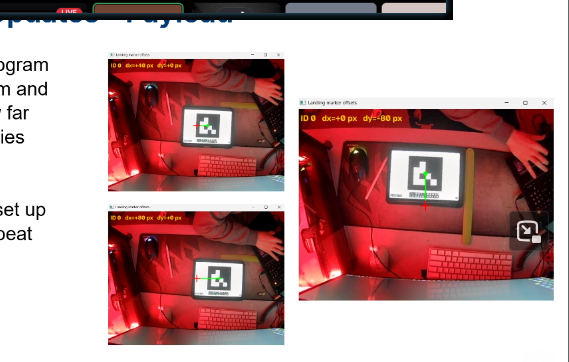
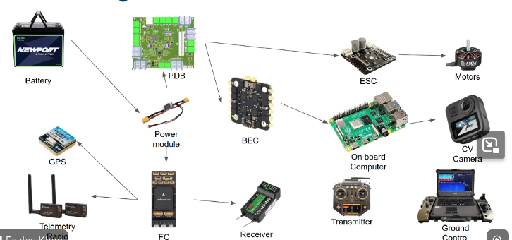

Meeting Notes : 2026-11-15

## Updates Since Last...

- Logging system was created by Zain , tickets will be used , creation of sheet where roles & purpose will be better defined.

- Handbook will be distributed to the team leads/members created by Zain & Faz, outlines how teams will operate, once structure is created, leads will be reached out to regarding said outline. All team leads will fill out the doc. 

- For the purposes of documentation team leads, will write a weekly journal/log about day to day operations.

- Faculty was reached out to ( Sydney & Travis ) however no updates to report on , Thaddeus is drafting email from Travis.

### **Mech Updates**

Week 2 research is finishing up, Mech meeting will take place to keep everyone up to date post General Meeting. Individual review will occur next week, research will be further refined.

A more strict project scope will be outlined very soon.

### **Payload Updates**

**New  Members:**
	Omar transferred into payload

CV research was paused due to member midterms,
Carry & place research detail will start to become more finalised

Lead (Avinash) drafted a document covering all past AEAC Competitions , task estimated payload weight in order to plan for future events
Liam wrote python CV program to track a marker positions. 

### **Avionics Updates**

**New  Members:**
	Uvin , Marco , Hassan have been brought onto avionics.

Pixhawx 6x has been selected as the flight controller due to desirable specs, (H7) processing power, RAM , CC compatibility. Pixhawk contains 8 UART ports.

Cost is estimated at 450-500$,

Lead (Homesh) outlined briefly how the components interacted with each other:
    FC acts as a hub, interfaces with batter via power module , battery distributes power via power distribution board.     

ESC will be 4 single motor ESC as a failsaife in case the 4-1 fails. 4-1 ESC's are subject to catastrophic failure that the team may not necessarily have the skills & technical know how to repair in comp. More considerations will be taken down the line especially for the prototype drone.

### **Software Updates**

Currently undergoing interviewing phase ( interviewed Bach , Ramisa, Absar). Teams will be divided into 3 Sections ( Flight & Safety , Mission & Data, Sim & Infrastructure) . Since software is not waiting on parts work may begin much sooner.
 
### **Finance**

**New  Members:**
	Ziad was interviewed and onboarded for the finance team

Reached out to avionics, to get a prince range for components, for the sake of sponsorships and gaining funding.

Upcoming interviews will occur with software, Mech, Payload to get as many cost related estimates.

**Sponsor Alerts:**
	**Protocase**: expressed interest in offering a possible 500$ sponsorship.

Thaddeus has drafted an email for Travis regarding school finance. Hoping to get second opinions before finalising and sending the draft.

### **Outreach**

Technical onboarding will begin to slow.
Mahreen has organized an upcoming information night to get word out at the school.
