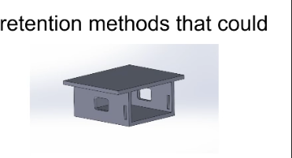

2026-11-22

## Updates Since Last...

OTAS drive has finally been configured 

Many new members have joined...

For new members : we are focusing on building knowledge base year 1 and building the team at the moment. Aim is to build a model drone before 2027 September.

New members are recommended to read proposal doc.

Zain promoted to CEO , will be leading technical teams and working alongside Muhamad as a lead.

### **Mech Updates**

Project Scope has been set ( talks have been in the work with other departments , Drone will be estimated at 10kg , 15kg loaded.) 

Motor requirements have been set , motor voltage ratings ( 100 -  170KV) 
Motor Trust estimations have been set

**New Members :**
	Liz & Saad have been brought on 
	estimating 4 new members

sponsorship item list has been sent & is currently under review.

### **Payload Updates**

Rafael has created a rough cad draft of a carry and place model

This weeks projects: 

- Liam: Continuing work on CV and Precision landing

- Rafael: Continuing work on Payload Carrier and refining the design

- Hamza/Omar: Continuing to work on CV simulation environment for testing

- Areeb/Absar: Going over the past comps doc to get familiar with what will be doing.

### **Avionics Updates**

**New Members :**
	Uvin,
	Marcos,
	Hassan

Competition guidelines outline that an emergency stop is physically required to start. 

**Member Tasks**

- William : ESC , PDB research 

- Yazhou : Batteries , Flight time estimations ( 30m flight time / 1 hour give or take )

- Deo : Transmitter / Reciever research. Investigating ( EMC interferance related )

All new members are being familiarized with drone components before task assignment.

ESC/Bat research should be made around the motors ( Mech dept ) 

**Current Estimations/Deadlines**

"We want to have our overall architecture done by new years. Then have our design review with everyone. And order parts by latest end of January. The current limiting factor in our research is knowing our departments budget."

### **Software Updates**
**New Members:**
	Bach,
	Zachary,
	Ramisa,
	Absar,
	Juan,

**Tasks:** 
Learn about Gazebo Simulations 
Take a look at the past competitions
Formal onboarding later this week

### **Media & outreach ** 

Parker & Faz had a meeting with company Mantera for a sponsorship, however the company was interested in monetary return on investment, so maybe further down the line.

Will be giving out tasks similar like the past week: 
- Finally have our LinkedIn Post ready
- Will be focusing more on LinkedIn for Sponsorship goals
- Let me know if you need any members
- Going to pre make Instagram Reels and posts
- Will be planning our first event
- Been discussing some ideas for reels and events

Heavy efforts will be placed into LinkedIn based outreach in order to attract sponsors. LinkedIn post will be made very soon...

